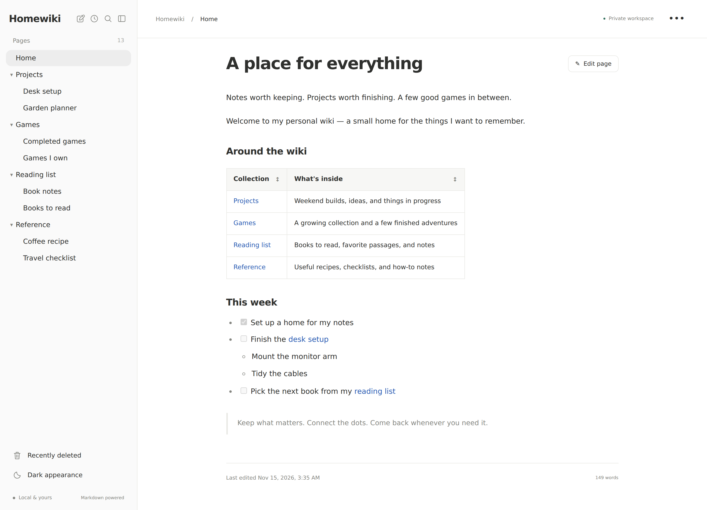
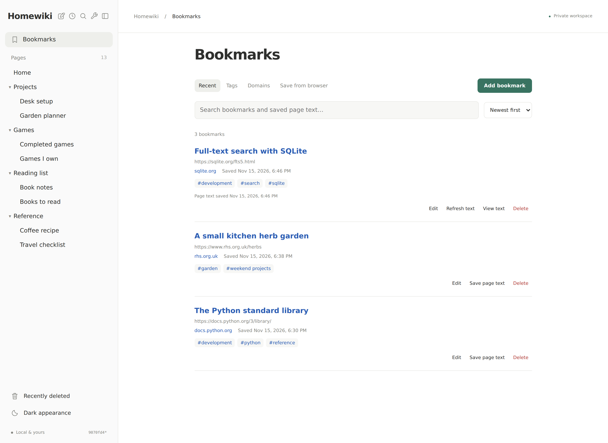

# Homewiki

After looking for years, I couldn't find a simple wiki for home internal use that I liked. So I used Codex to build one.

**NOTE: this is meant for internal use only, do not expose this to the internet**

Homewiki is a lightweight, locally hosted personal wiki and bookmarking system. Wiki pages are ordinary UTF-8 Markdown files in nested folders. The bookmark library uses SQLite. There is no build step or third-party runtime dependency.

- Collapsible sidebar, light/dark themes, and clean page URLs with clickable breadcrumbs.
- Markdown pages with nested folders, drag-and-drop sidebar ordering, internal links, search, and image uploads.
- Browser editor with preview, draft recovery, edit conflicts, page history, and version restore.
- Sortable tables, nested lists, clickable breadcrumbs, and a Recently edited index.
- A bookmark library with editable titles, tags, original bookmark dates, and browsing by tag or domain.
- Page titles fill in while adding a URL and remain editable. Page-text saving is enabled by default for new bookmarks, with full-text search across saved text and bookmark details.
- Recoverable deleted wiki pages; bookmark deletion is permanent.
- Docker Compose and Unraid support with persistent storage.

## Screenshots

Example content in the current interface. Images follow your light or dark theme.

### Wiki

<picture>
  <source media="(prefers-color-scheme: dark)" srcset="docs/images/homewiki-dark.png">
  
</picture>

### Bookmarks

<picture>
  <source media="(prefers-color-scheme: dark)" srcset="docs/images/bookmarks-dark.png">
  
</picture>

## Run on Unraid

Use the published `ghcr.io/rroller/homewiki:latest` image with the [Homewiki Unraid template](https://github.com/rroller/unraid-templates/blob/master/ronnieroller.com/homewiki.xml). No local build or GHCR login is needed.

1. For a **new** install, create the data directory in the Unraid terminal:

   ```sh
   install -d -m 0700 -o 10001 -g 10001 /mnt/user/appdata/homewiki/data
   ```

2. Install the template as `/boot/config/plugins/dockerMan/templates-user/my-homewiki.xml` using the [safe installation commands](UNRAID.md#2-install-the-user-template). An existing configured user template is kept intact.
3. Open **Docker → Add Container**, select **homewiki**, and configure:

   | Field | Value |
   | --- | --- |
   | Repository | `ghcr.io/rroller/homewiki:latest` |
   | Web port | `18080` or another unused port |
   | Wiki data | `/mnt/user/appdata/homewiki/data` → `/data`, read/write |
   | Allowed hosts | Your Unraid IP and any wiki hostname, comma-separated; no scheme or port |

4. Click **Apply**, enable **Autostart** if desired, and open the container's **WebUI**. The default URL is `http://YOUR_UNRAID_IP:18080/Home`.

Keep the full `/data` mapping across updates: it contains pages, uploaded images, recoverable trash, and state. Use Unraid's **Check for Updates / Update** controls for new images; publishing to `:latest` does not automatically replace a running container. Back up the entire data folder with the app stopped. Homewiki has no built-in authentication, so keep access private or provide separate access controls.

See the [full Unraid guide](UNRAID.md) for template installation, custom hostnames, backups, permissions, troubleshooting, and the optional source-build script.

## Run locally

Requires Python 3.10+ with SQLite FTS5 support on Linux or macOS (`fcntl` provides the file lock).

```sh
python3 server.py
```

Open **http://localhost:8080**. Stop with Ctrl+C. The default listener is `127.0.0.1`; data lives in `data/` beside the server.

```sh
python3 server.py --port 8090 --data /path/to/my-homewiki
```

The first run seeds a few generic starter pages only if the pages folder is empty. Existing files are never seeded over. Use `--no-seed` to start with an empty wiki.

## Docker Compose

Requires Docker with the Compose plugin:

```sh
docker compose up -d --build
```

For a manual image build with a commit link, pass the revision as a build argument:

```sh
docker build --build-arg HOMEWIKI_REVISION="$(git rev-parse HEAD)" -t homewiki .
```


Open http://localhost:8080. Compose publishes only on `127.0.0.1`; the named `homewiki_data` volume persists pages and trash across container restarts and rebuilds. The container runs as a non-root user with a read-only app filesystem.

```sh
docker compose logs -f
docker compose down
```

`down` preserves the volume. `down -v` deletes it. The Python `data/` folder and Docker named volume are separate stores.

A published `linux/amd64` image is available as `ghcr.io/rroller/homewiki:latest`, with commit-specific `sha-<full-commit>` tags. Publishing runs the storage/HTTP tests and a read-only container smoke test before pushing.

See [Unraid instructions](UNRAID.md) for a bind-mounted appdata deployment.

## Private access

Homewiki is intended for a trusted personal environment and has no login system. Keep it off the public internet. Other programs running under your OS account can access its files.

For a remote server, retain the default localhost listener and tunnel from your computer:

```sh
ssh -N -L 8080:127.0.0.1:8080 your-user@your-server
```

For intentional access from trusted devices on a private LAN, bind to the server's actual LAN IP and allow that exact Host:

```sh
python3 server.py --host YOUR_LAN_IP --port 18080 --allow-host YOUR_LAN_IP
```

Docker deployments can set `HOMEWIKI_ALLOWED_HOSTS` to the permitted IP/hostname and publish on that specific LAN address. Anyone who can reach the permitted endpoint can read and edit the wiki. Host/Origin checks and the mutation header protect against cross-origin browser requests; they are not authentication.

## Use the wiki

The sidebar toolbar contains New page (pencil), Recently edited (clock), Search (magnifying glass), Settings (wrench), and the sidebar toggle. Open **Settings** from the wrench or the footer for appearance, deleted pages, backups, and browser bookmark setup. Only top-level page groups have collapse arrows; their nested pages stay expanded when the group is open. Drag a page or group above/below a sibling to set its order, or focus it and press Alt+↑/↓. Ordering is saved on the server for all browsers and never changes page paths. New pages appear after ordered siblings; deleted entries are ignored.

Use the upper-right **••• → New subpage** menu to create a child of the current page. Enter its name; Homewiki adds the parent path automatically. Unsaved work on the parent stays in its browser draft.

Choose **Edit page → Visual** to edit headings and paragraphs directly, apply bold or italic, or create lists. The **Markdown**, **Visual**, and **Preview** tabs use the same draft. Visual mode also lets you edit existing list items, table cells, quotes, and code blocks. Use Markdown mode to add or remove table rows and columns.

A leading `# Heading` supplies the visible page title and browser-tab title. Editing it updates the rendered title after saving. The heading is shown once at the top, rather than duplicated in the article. Without a leading H1, the filename supplies the page title and Markdown headings render in the article. Page paths, sidebar labels, and internal links continue to use the filename; use Rename / move to change them.

Create nested pages with paths such as `Games/Completed games`. A folder may also have its own page: `Games.md` beside `Games/Completed games.md`.

Use `[[Games/Completed games]]` or `[[Games/Completed games|Finished games]]` to link from the wiki root. The editor's page-link picker inserts these links. Ordinary Markdown links resolve relative to the current page's folder; begin the target with `/` for a wiki-root-relative link. Paths are case-sensitive. Missing pages offer to create them.

Plain web addresses such as `https://example.com`, `www.example.com`, and `example.com` become clickable; bare domains use HTTPS. Standard `[label](https://example.com)` links and `<https://example.com>` autolinks also work. Code spans/blocks and email addresses remain text. Click the Homewiki name at the top of the sidebar to return Home.

Page URLs use `/Home` or `/Games/Completed%20games`, with no `/page/` prefix. Direct links, refresh, and browser back/forward work. Older `/page/...` and `/#/page/...` links open at their equivalent clean URL. Application route names (`api`, `uploads`, `page`, `recently-edited`, and static asset names) are reserved; pages using those top-level names remain accessible through `/page/<path>` to avoid conflicts. Breadcrumb ancestors link back to parent pages and Home.

Ctrl/Cmd+K opens search; Ctrl/Cmd+S saves an edit. Closing the editor retains its browser draft; Discard draft removes it. Rename/move changes only the selected Markdown file. Children and links to its old path remain unchanged, and existing destinations are never replaced.

Delete moves a page into Recently deleted. Children remain accessible. Restore it through **Settings → Recently deleted**; if the original path is occupied, move that replacement first. Use **Delete permanently** for one entry or **Empty trash** for all listed entries. Both actions require confirmation and remove only the trash copies. Page history and existing backups are kept. Trash has no automatic expiry.

The footer uses the Markdown file's modification time for its last-edit date, displayed in the browser's local time zone. Recently edited (`/recently-edited`) is a generated index ordered newest first. It includes external file edits, excludes deleted pages, and is not itself an editable Markdown file. Renaming or restoring a page preserves its content edit date.

## Add images

Drop one or more images onto an open page, paste a screenshot into the editor, or choose **Add image**. A drop on a reading page opens its editor. PNG, JPEG, GIF, and WebP are supported, up to 10 MiB per image. SVG and other file types are rejected. File signatures determine the stored type; client filenames are never used as storage paths.

Uploads insert ordinary Markdown such as `` at the cursor. Images appear in Preview and saved pages; click one to open its original size. Save the page to commit the image links. Save waits until that page's uploads finish. You can continue typing or navigate to another page while an upload finishes; the result updates the original browser draft. If a reload interrupts an upload, the text draft is recovered and the unfinished upload placeholder is removed with a notice to try again.

Images are ordinary files in `data/uploads/`, on the same persistent volume as the pages. Absolute upload URLs keep working after moving/renaming a page. Images are retained when a page is deleted, restored, or its draft is discarded, so recoverable pages and shared links do not lose their files. There is no automatic cleanup of unused uploads. Include `uploads/` in data backups. Uploaded assets are excluded from Git and from the image build context. External image URLs and raw HTML are not rendered or requested.

The small Markdown renderer supports headings, paragraphs, bold, emphasis, strikethrough, inline/fenced code, nested bullet and numbered lists, read-only task lists, blockquotes, tables, horizontal rules, and links. It is not full CommonMark: raw HTML and unsupported extensions are not rendered. HTML appears as text; remote images are not requested. External HTTP(S) links open separately when clicked.

### Tables

Table headers stay on one line; wide tables scroll horizontally. Click a heading (or focus it and press Enter/Space) to sort ascending, then click again to sort descending. Numeric columns sort numerically; text uses case-insensitive natural ordering. Empty cells stay last in either direction. Sorting affects only the current preview or reading view and does not rewrite the Markdown.

### Nested lists

Indent child items with spaces or tabs. Two- and four-space bullet lists work, and bullet, numbered, and task lists can be mixed. Indented continuation paragraphs and fenced code stay inside their parent item. Numbered lists preserve their starting number; both `1.` and `1)` markers work.

```markdown
- Games
  - Completed
    - A favorite adventure
  - Up next
    1. Choose a game
    2. Start playing
- [ ] Reading
  - [x] Finish the first chapter
```

## Bookmarks

Open **Bookmarks** in the sidebar, then **Add bookmark**. Save a web address, an optional title and comma-separated tags. After you type or paste a public URL, its title is filled into the form for you to review and edit. Changing the URL replaces an automatically filled title, while a title you have edited is kept. If unavailable, you can enter a title yourself or leave it blank to use the domain. Tags are case-insensitive and may contain spaces. Click a suggested tag to add it, or type in the field to autocomplete existing tags. Suggestions include topics from the title, publisher tags, and recurring words and phrases in readable public pages. Homewiki generates them locally when it looks up the page title. The page text is only stored if you choose to save it for search. Saving a new bookmark returns you to **Recent**. The original bookmark time stays the same when you edit its details.

- **Recent** lists newly bookmarked links first. You can also sort by oldest first or title.
- **Tags** shows all tags and their bookmark counts. Click one to browse its links; clicking another tag on a bookmark narrows the list to links carrying both tags.
- **Domains** groups links by hostname. Click a domain on a bookmark or on the domain index to see its links. The www prefix is ignored; other subdomains remain separate.
- Search matches words across titles, URLs, tags, and saved page text. Words use prefix matching and are combined; search can be combined with tag and domain filters. Filters are in the URL, so reload and browser history work.
- **Delete** permanently removes a bookmark, its tags, and its saved page text after confirmation. Duplicate URLs are rejected while bookmarked; after deletion, a URL can be added again.

**Save page text for search** is checked by default for new bookmarks; uncheck it if you only want the link and title. **Save page text / Refresh text** on an existing bookmark retries extraction; **View text** shows what was saved. Extracted titles are used only when you leave the title empty. A failed fetch still saves your link and tags; a failed refresh keeps previously extracted text. Changing the URL clears text from the old address.

Extraction reads public HTML or plain-text pages without cookies, credentials, scripts, or browser rendering. Private/LAN links can be bookmarked normally, but their text is not fetched. Each extraction accepts up to 2 MiB of source and stores up to 300,000 characters; login-only, compressed-only, or JavaScript-dependent pages may not yield useful text.

Bookmark forms keep drafts in this browser. Reopen Add/Edit after a reload to recover one, or choose **Discard draft**. Conflicting edits keep your form and offer a comparison with the latest bookmark before you save a reviewed draft.

Bookmark data, tags, and the full-text index live in bookmarks.sqlite3 under the existing data directory. Wiki Markdown storage is unchanged. Include the whole data directory in stopped-container backups; do not commit bookmark databases or extracted text to Git. Docker and Unraid need no extra mount or service.

## Save from Safari, a bookmarklet, or an extension

Open **Settings → Open browser setup** (the /settings/browser page) using the same Homewiki address you normally use on your phone. The page generates a **Save to Homewiki** bookmarklet for that address.

On iPhone Safari:

1. Tap **Copy bookmarklet**.
2. Use Safari’s **Share → Add Bookmark**, name it **Save to Homewiki**, and save it in **Favorites**.
3. Open **Bookmarks → Favorites → Edit**, edit that bookmark, and replace its address with the copied code, including the leading javascript:.
4. While reading a page, open Favorites and tap **Save to Homewiki**. The capture form receives its URL and current title. Review the fields, add tags, and tap **Save bookmark**. Use Back to return to the original page.

On desktop, drag the **Save to Homewiki** link to your bookmarks bar. Some pages or browsers block bookmarklets; a shortcut or extension can open the capture address directly instead. See [Apple’s Safari bookmark guide](https://support.apple.com/guide/iphone/bookmark-a-website-iph42ab2f3a7/ios) and [JavaScript URL limitations](https://developer.mozilla.org/en-US/docs/Web/URI/Reference/Schemes/javascript).

### Capture address

The dedicated page is **/bookmarks/add**. Opening it only prepares a form; saving always requires a click. It works as a direct link, a mobile shortcut target, or a destination opened by a browser extension.

```text
/bookmarks/add?url=https%3A%2F%2Fexample.com%2Farticle&title=Article%20title
```

| Query parameter | Purpose |
| --- | --- |
| url | The page address, URL-encoded. |
| title | Optional prefilled title; omitted titles are looked up automatically. |
| text | Shared text; if url is omitted, its first HTTP(S) URL is used. |
| tags | Optional comma-separated tags. Repeated tag parameters also work. |
| extract | Page-text saving defaults on; use 0 or false to start unchecked. |

Titles and tags remain editable. Capture drafts are kept separately for each shared URL and do not replace an unfinished bookmark in the normal Add dialog. A successful save opens **Recent**. Reloading shows the bookmark list. The capture page does not follow return-URL parameters or save/edit a bookmark from query parameters alone.

## Page history

Open **••• → Page history** to browse earlier saved versions. Choose a version to see a highlighted comparison against the current page, or switch to **Saved Markdown** to read its full source. Minus lines belong to the selected version; plus lines belong to the current page.

**Restore this version** asks for confirmation, then makes the selected content current. The content it replaces is kept in history, so you can undo a restore. A newer edit blocks a stale restore. Save or discard a local draft before restoring; browsing history preserves it.

Homewiki snapshots the current Markdown before each changed save, restore, or deletion. Existing pages get their first earlier version when next changed; unchanged saves do not add entries. Renames copy history to the new path, and recovering a page from trash keeps its history. Versions belong to page paths, so reusing an old path also makes its earlier versions available.

History uses Markdown snapshots and JSON metadata under the persistent data folder's hidden .history directory. It has no automatic expiry; include it in backups and allow space for saved versions. File edits made outside Homewiki are captured only when their current content is subsequently changed or deleted through Homewiki. Intermediate external edits cannot be reconstructed.

The bottom of the sidebar shows the running version’s short Git hash and links to its GitHub commit. Published images embed the exact build revision. Local checkouts use their revision at startup; an asterisk marks uncommitted changes. Source copies without build metadata show **Development**.

## Storage and durability

```text
data/
  pages/
    Home.md
    Games.md
    Games/
      Completed games.md
  uploads/
    <unique-id>.png
  .trash/<unique-id>/
    page.md
    metadata.json
  .history/<page-path-hash>/<version-id>/
    page.md
    metadata.json
  bookmarks.sqlite3    Bookmark library, tags, and full-text index
  .sidebar-order.json   Shared manual sidebar ordering
  .initialized
  .lock
```

**Keep personal wiki content outside Git.** This repository contains application source and documentation only. The ignore rules exclude Markdown except the explicitly allowed root documentation, plus runtime data, trash, backups, and local configuration. The Docker build context allows only runtime source. For a custom data directory, prefer a path outside this checkout. Never force-add wiki data or backup files.

You can edit UTF-8 `.md` files with any text editor. The app discovers them on refresh and polls every ten seconds while visible. Hidden names, traversal paths, and symlinks are rejected. Each Markdown page/JSON request is limited to approximately 2 MiB; each image upload is limited to 10 MiB. Search scans the files and is intended for a small personal collection.

Saves flush a temporary file and atomically replace the page. A cross-process advisory lock serializes UI mutations. SHA-256 revisions reject stale saves, renames, and deletes. The conflict dialog shows the current file, your draft, an editable merged draft, and a draft download. Accepting a merge updates its base revision; Save checks again. External editors do not acquire the advisory lock, so avoid simultaneous external writes during a UI save.

Unsaved edits go immediately into localStorage with separate keys for tabs. Revisiting a page or reloading recovers a draft. If browser storage fails, the editor warns and prompts before leaving with unsaved work. Browser drafts belong to the origin, including its port; clearing site data removes them. They are not server backups.

### Backup and restore in Homewiki

Open **Settings** at the bottom of the sidebar and choose **Manage backups**. **Download backup ZIP** saves your Markdown pages, uploaded images, page history, trash, sidebar order, and bookmarks in one file. The ZIP contains saved server data. Browser drafts and appearance preferences live in each browser.

To restore, select a Homewiki backup ZIP, check **Replace my current saved data**, then choose **Restore backup**. Homewiki checks the ZIP first and keeps a separate ZIP of the data it replaces. To retrieve that snapshot, reopen the dialog and choose **Download ZIP from before the last restore**. Download that snapshot before another restore if you want to keep it.

The ZIP limit is 2 GiB uploaded or downloaded, with up to 8 GiB expanded and 50,000 entries. Allow space in the data volume for the ZIP, expanded files, and the pre-restore snapshot. Pause direct edits to the data folder while Homewiki creates or restores a backup.

Back up the complete server-side data folder, including `.trash`, `.history`, and hidden files, with edits paused or the app stopped. For Docker, back up the volume or bind mount and preserve ownership (UID/GID 10001). Keep data when replacing the container. A volume copy while the container is running but edits are paused can be made to a fresh destination with:

```sh
docker compose cp homewiki:/data ./homewiki-backup
```

## Tests

The storage and HTTP tests need only Python's standard library and use temporary data:

```sh
python3 -m unittest discover -s tests -p test_server.py -v
```

Optional Chromium integration tests use Playwright, needed only for testing:

```sh
python3 -m venv .venv
. .venv/bin/activate
pip install playwright
python -m playwright install --with-deps chromium
python -m unittest discover -s tests -v
```

The suite covers file storage and CRUD, destination protection, external and concurrent edits, path safety, private request guards, direct page routes, persistent sidebar drag/keyboard ordering and conflicts, editor/preview/link/search flows, draft recovery, conflict merging, page history and safe version restore, bookmark CRUD/tag/domain/text search and extraction guards, trash/restore, themes, mobile layout, safe Markdown rendering, edit dates, recent-page ordering, image drop/paste/picker flows, upload failures and interruption, navigation during upload, and image persistence. Tests do not edit your real wiki.
